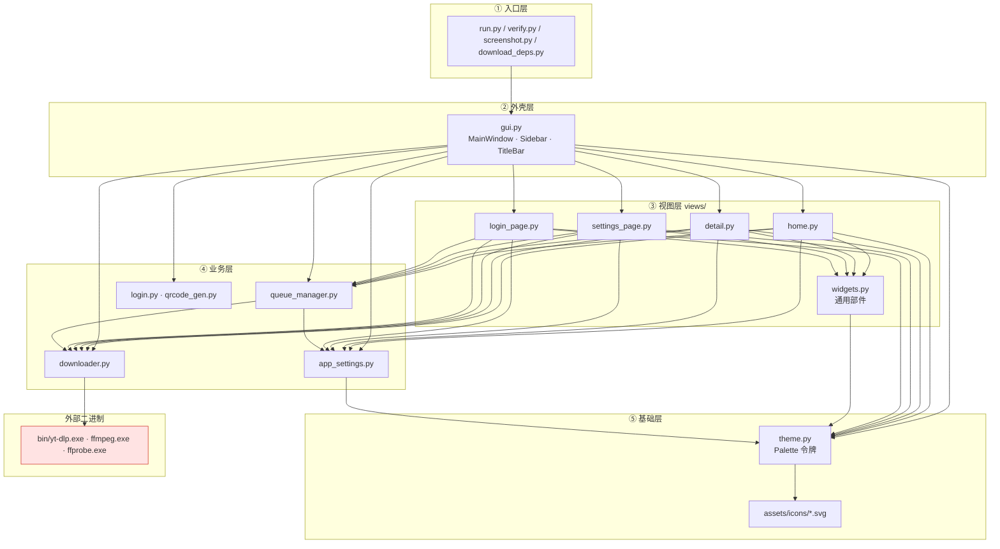
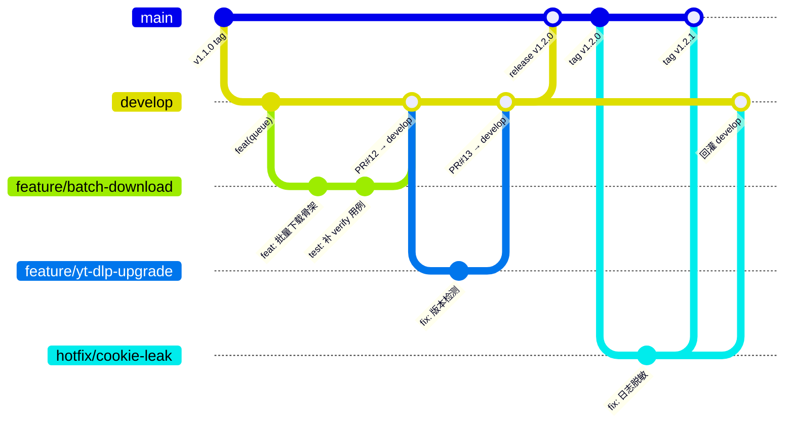

# 技术协作规范

> 适用：B 站视频下载器（Windows 桌面端，PySide6 6.12 + Python 3.13）
> 定位：**定义"代码怎么写、往哪放、怎么合、怎么发"**。需求与交付流程见 [`02-交付流程SOP.md`](02-交付流程SOP.md)，实现细节与踩坑见 [`开发者指南.md`](../开发者指南.md)。
> 本规范的每一条都尽量给了「为什么 / 违反会怎样」，不确定时以本文件为准，本文件与 `开发者指南.md` 冲突时以本文件为准并回改后者。

**当前基线**：v1.1.0 ｜ 分支 `develop` 为集成主干 ｜ 验收命令 `python verify.py`

---

## 1. 模块边界与依赖规则

### 1.1 四层结构（依赖只能向下）



**一句话**：`入口 → 外壳 → 视图 → 业务 → 基础 → 外部二进制`，箭头单向，禁止回指。

### 1.2 各层职责与允许范围

| 层 | 目录/文件 | 允许做什么 | 禁止做什么 |
|---|---|---|---|
| 入口 | `run.py` 等根目录脚本 | 拼装 `sys.path`、构造 `MainWindow`、跑自检 | 写业务逻辑（无法被 GUI 复用） |
| 外壳 | `gui.py` | 窗口/标题栏/侧边栏/页面栈、**组装上下文 `_ctx()`**、跨页面跳转 | 直接发下载、直接解析 URL |
| 视图 | `views/*.py` | 画界面、读 ctx、调 manager 的**公开方法**、发自己的信号 | 见 1.3 |
| 业务 | `queue_manager.py` `downloader.py` `login.py` | 调度、子进程、网络、凭证 | `import PySide6.QtWidgets`（不能弹窗，见 1.3 第 5 条） |
| 基础 | `theme.py` | 定义令牌、生成全局 QSS | 反向依赖任何上层 |

### 1.3 禁止的导入（硬性，PR review 必查）

| # | 禁止 | 理由 / 违反后果 |
|---|---|---|
| 1 | `views/` 内任何文件 `import subprocess` / `yt_dlp` / 直接执行 `bin/` 二进制 | 页面跑在 GUI 线程，同步子进程会**冻结整个窗口**（无边框窗口连拖动都卡死，用户以为崩溃）。耗时的解析也必须用 `QThread`（参考 `home.py::ParseWorker`、`detail.py::PagesWorker`） |
| 2 | `views/` 之间互相 import（如 `home.py` import `detail.py`） | 页面间就变成编译期耦合，删一个页面要动另一个；页面间通信统一走 `gui.py` 中转（`open_detail`、`login_succeeded` 等信号） |
| 3 | `views/` 内除 `widgets.py` 外的横向依赖 | `widgets.py` 是**唯一的共享部件层**；通用部件（新按钮/新徽章/新开关）一律下沉到这里，不要复制到各页面 |
| 4 | 业务层（`queue_manager` / `downloader` / `login`）import `views` 或 `gui` | 反向依赖会让后台逻辑无法在无 GUI 环境下测试，`verify.py` 直接跑不起来 |
| 5 | 业务层 `from PySide6.QtWidgets import QMessageBox` | 业务代码运行在 worker 线程，**子线程弹模态框是未定义行为**（可能静默失败或直接崩）。要提示就发信号给主线程 |
| 6 | 任何层 import `tkinter` | 本 Python 发行版未编译 Tcl/Tk，import 直接 `ModuleNotFoundError`；`.spec` 已 `excludes=['tkinter']` |
| 7 | 视图层直接读写 `data/settings.json` | 必须走 `AppSettings.get/set`。绕过会导致默认值缺失、写盘失败静默丢失、并发写坏文件 |
| 8 | 视图层直接 `manager.tasks.append()` / 改 `t.state` | 状态机在 `queue_manager` 里，外部直改会跳过 `_pump()` 调度，出现"显示等待中但永远不动" |

### 1.4 上下文传递约定

页面统一通过 `MainWindow._ctx()` 拿依赖，**不要**自己 new：

```python
def _ctx(self) -> dict:
    return {"settings": self.settings, "dl": self.dl,
            "manager": self.manager, "login": self.login, "shell": self}
```

新增 ctx 键必须同步改 `_ctx()`；页面里 `ctx["xxx"]` 取值前先确认键存在（拼错键是 `KeyError` 白屏，不报错到日志）。

---

## 2. 变更文件清单模板

### 2.1 新增一个页面（例：新增「已完成」页 `done.py`）

| 步骤 | 文件 | 改动 |
|---|---|---|
| 1 | **新建** `bilidownloader/views/done.py` | 类 `DoneView(QWidget)`，`__init__(self, ctx, palette)`，颜色一律 `self.p.xxx` |
| 2 | `bilidownloader/gui.py` | import 新类；`_build_ui()` 里 `self.view_done = DoneView(...)` 并 `self.stack.addWidget(v)`；`navigate()` 的 `views` 字典加键；`_update_nav_selection()` 加选中态；`apply_theme()` 里调 `self.view_done.retheme(p)` |
| 3 | `bilidownloader/gui.py::Sidebar` | 加 `NavItem(icon, 文本)` 并 `clicked → self.navigate.emit("done")` |
| 4 | `bilidownloader/assets/icons/` | 需要新图标则放 SVG（`stroke="currentColor"`，不要写死颜色） |
| 5 | `screenshot.py` | 加入截图列表，保证视觉回归覆盖 |
| 6 | `verify.py` | 至少加一条静态/构造检查 |
| 7 | `docs/` 相关文档 | `开发者指南.md` 架构树 + 本规范「共享知识」必读清单 |

> ⚠️ `navigate()` 用 `list(views).index(key)` 定位，**字典顺序必须与 `addWidget` 顺序严格一致**，否则跳错页。

### 2.2 新增一个下载选项（例：新增「仅封面」开关）

| 步骤 | 文件 | 改动 |
|---|---|---|
| 1 | `bilidownloader/queue_manager.py` | `Task.__init__` 加字段（有默认值，保证旧任务可构造）；`DownloadWorker` 透传 |
| 2 | `bilidownloader/downloader.py` | `build_download_cmd()` 加开关映射；`download()` 加同名参数（**两者签名必须一致**，否则续传命令与首次命令不一致，`.part` 断点失效） |
| 3 | `bilidownloader/app_settings.py` | 若需持久化：`DEFAULTS` 加键（**必须给默认值**，`load()` 只接受已存在于 `DEFAULTS` 的键） |
| 4 | `bilidownloader/views/home.py` | 解析卡加勾选框；构造 `Task(...)` 时传入 |
| 5 | `bilidownloader/views/detail.py` | 详情页同样加（两个入口的选项应保持一致） |
| 6 | `bilidownloader/views/settings_page.py` | 若作为全局默认项，加开关并 `ctx["settings"].set(...)` |
| 7 | `verify.py` | 加一条选项生效的断言 |

### 2.3 新增一个通用部件

只改 `bilidownloader/views/widgets.py`（新增类/函数）→ 使用方页面 import。若该部件有状态色，**从 `palette` 取，不要写死**。

---

## 3. 分支策略

### 3.1 分支类型与生命周期

| 分支 | 来源 | 合入方向 | 生命周期 | 说明 |
|---|---|---|---|---|
| `main` | — | 只接受 `develop` 或 `hotfix/*` | 永久 | **始终可发布**；每次合入打 tag |
| `develop` | `main` | → `main`（发布时） | 永久 | 集成分支；所有 `feature/*` 的 PR 目标 |
| `feature/<短名>` | `develop` | → `develop`（PR） | 合并即删 | 例：`feature/batch-download`、`feature/subtitle-page` |
| `hotfix/<短名>` | `main` | → `main` **且** → `develop` | 合并即删 | 双合，避免修复在下一版丢失 |

命名：全小写、连字符分隔、≤3 个词。禁止中文分支名、禁止 `develop2` / `test-branch` 这类无意义名。

### 3.2 分支流转图



### 3.3 PR 要求

**PR 描述模板**（复制使用）：

```markdown
## 改了什么
- （一句话）

## 为什么
- 关联需求/缺陷：（编号或现象描述）

## 影响范围
- 涉及层：视图 / 业务 / 打包
- 涉及页面：首页 / 详情 / 设置 / 登录
- 是否改了 Task 字段、settings 键、QSS 选择器：（是 → 说明兼容处理）

## 自测
- [ ] `python verify.py` 全绿
- [ ] `python screenshot.py` 四页截图无样式泄漏（无多余方框/黑底）
- [ ] 亮色 + 暗色 + 跟随系统 三种主题都看过
- [ ] 退出时无残留线程（关窗不崩）

## 文档同步
- [ ] `开发者指南.md` / `使用说明.md` / `CHANGELOG.md` 已按需更新
```

**Review 关注点（按优先级）**

1. **分层是否被破坏**：视图层有没有偷偷调 subprocess / 跨页面 import（1.3 表逐条过）。
2. **线程安全**：worker 里有没有碰 Qt Widget；耗时操作有没有离开 GUI 线程。
3. **样式来源**：有没有硬编码颜色、有没有漏 `#ObjectName` 限定（见 5.2）。
4. **状态机完整性**：新增状态/字段后，`pause/resume/retry/remove/_on_done` 是否都覆盖了。
5. **兼容**：`Task` 新字段有默认值吗？`DEFAULTS` 新键有默认值吗？旧 `settings.json` 能加载吗？
6. **凭证安全**：有没有把 `SESSDATA` / cookie 内容打进日志或截图。

**合并规则**：至少 1 人 approve；**提交者不得自己 approve**（与 SOP 第 1.4 条一致）；`verify.py` 必须全绿。

### 3.4 Hotfix 流程

1. 从 `main` 切 `hotfix/<短名>`；
2. 修复 + 升 PATCH 版本号 + 补 `CHANGELOG.md`；
3. PR → `main`，合并后打 `vX.Y.Z` tag；
4. **立刻**再开一个 PR 把同一提交回灌 `develop`（或用 `git merge` 后推），漏了这步修复会在下一次 release 被覆盖掉。

---

## 4. 提交与版本规范

### 4.1 Conventional Commits

格式：`type(scope): 中文简述`，scope 可选但**跨模块时必须写**。

| type | 何时用 | 是否升版本 |
|---|---|---|
| `feat` | 新增用户可见功能 | MINOR |
| `fix` | 修复缺陷 | PATCH |
| `perf` | 性能优化（用户可感知） | PATCH |
| `refactor` | 重构，行为不变 | — |
| `docs` | 只改文档 | — |
| `test` | 只改 `verify.py` / 测试 | — |
| `chore` | 依赖、打包、脚本、.gitignore | — |

> 共 7 类。`02-交付流程SOP.md` 只引用了 `feat/fix/docs/refactor/chore` 五类，这是精简列举；**完整以本表为准**（`perf` 与 `test` 同样合法，请一并使用）。

**本项目示例（照抄风格）**

```
feat(queue): 支持暂停后续传使用同一条命令
fix(login): 读取 data.code 判定扫码状态而非外层 code
fix(theme): 亮色模式强调色改为 #E0456F 保证对比度
refactor(views): 侧边栏导航项抽成 NavItem 部件
chore(pack): spec 补上 bilidownloader/assets 资源
```

**scope 取值建议**：`gui` `home` `detail` `settings` `login` `queue` `downloader` `theme` `widgets` `pack` `deps`。

**规则**
- 一行 ≤ 72 字符；正文与标题间空一行；正文写「为什么」不写「做了什么」。
- 一个提交只做一件事；`fix` 与 `refactor` 不要混在一起（否则无法 cherry-pick 回灌 hotfix）。
- **绝不提交**：`data/`（`cookies.txt` 等同账号凭证）、`bin/`、任何含 `SESSDATA` 的日志或截图。提交前自查 `git status`。

### 4.2 版本号（MAJOR.MINOR.PATCH，当前 v1.1.0）

> 口径与 [`02-交付流程SOP.md`](02-交付流程SOP.md) 一致：MAJOR=不兼容变更、MINOR=向下兼容新功能、PATCH=缺陷修复 + 依赖升级 + 打包修正。

| 变更 | 升哪一位 | 例 |
|---|---|---|
| **不兼容变更**：删/改 `DEFAULTS` 键语义、改 `data/` 文件格式且无兼容读取、提升系统或 Python/Qt 最低要求、改 `Task` 字段语义 | MAJOR | 2.0.0 |
| **向下兼容新功能**：新页面、新下载选项、非破坏性结构调整 | MINOR | 1.2.0 |
| **缺陷修复 / 依赖升级 / 打包修正**：改 bug、改文案样式细节、**yt-dlp/ffmpeg 二进制升级**、`.spec` 与产物修复 | PATCH | 1.1.1 |

> 判定拿不准时按"用户要不要为此做任何事"来判：需要用户手动迁移数据或换环境 → MAJOR；什么都不用做、只是多了功能 → MINOR；什么都不用做、只是修好了 → PATCH。
> 注：二进制升级本身是 PATCH，但**若新 yt-dlp 要求改 `build_download_cmd()` 且旧设置不再适用**，按 MAJOR 处理。

**版本号单一真源 = `bilidownloader/__init__.py:: __version__`**，其余位置一律引用它。当前基线 **v1.1.0**（交付总监裁定：本次 UI 与后台整合为向下兼容的新功能集，按上表 MINOR 规则由 1.0.0 升至 1.1.0）。

> **历史遗留（已修复）**：曾存在版本号双真源——`gui.py` 硬编码 `APP_VERSION = "1.1.0"`，而 `__init__.py::__version__ = "1.0.0"`，侧边栏显示与 tag / 包元数据对不上（缺陷单 BUG-20261016-01）。现已按单一真源修好：`gui.py` 改为 `from . import __version__ as APP_VERSION`，不再硬编码。**此后禁止在任何文件里再写死版本号字面量**，新增展示位置一律引用 `__version__`。
> 防复发：`verify.py` 已加断言 `gui.APP_VERSION == bilidownloader.__version__`（见 §3.3 PR 模板「`verify.py` 全绿」）。

### 4.3 CHANGELOG

维护 `CHANGELOG.md`（仓库根目录），**每个 PR 顺手加一行**，不要等发布时回忆。格式：

```markdown
## [1.2.0] - 2026-10-16
### Added
- 侧边栏「已完成」页面与筛选（#12）
### Fixed
- 暂停后续传改用首次固化的命令，避免 .part 断点失效（#13）
### Changed
- 亮色强调色调深，满足 WCAG AA 对比度
```

未发布条目先堆在 `## [Unreleased]` 下，发版时改标题为版本号 + 日期。

---

## 5. 编码风格

### 5.1 Python

| 项 | 规范 | 为什么 |
|---|---|---|
| 命名 | 类 `PascalCase`；函数/变量/模块 `snake_case`；常量 `UPPER_CASE`；内部成员 `_xxx` | 与现有代码一致，一眼区分可见性 |
| 类型注解 | **公开方法与 `__init__` 参数必写**（`def add_task(self, task: Task) -> None:`）；局部变量可不写 | `Task`/`Palette` 字段多，IDE 补全与 review 靠注解 |
| Docstring | 中文，模块级 + 类级必写；方法级按需；一句话说清职责与副作用 | 参考 `queue_manager.py` 顶部说明 |
| 注释 | 中文；**注释写"为什么"**，复述代码的注释删掉 | 踩坑类注释必须保留（如"外层 code 恒为 0"） |
| 行长 | ≤ 100 字符 | 与现有 QSS 长字符串折行风格一致 |
| 函数规模 | 单函数 ≤ 60 行；超了就拆（`_build_ui` / `_start` / `_pump` 已是范例） | — |
| 模块规模 | 单文件 ≤ 600 行；`home.py` 已 26KB，新增 UI 请优先抽到 `widgets.py` | 否则 review 看不完 |
| 导入 | 标准库 → 第三方 → 本包相对导入（`from ..downloader import ...`）；**禁止 `from xxx import *`** | — |
| 捕获异常 | `except Exception` 必须写日志或降级，**禁止裸 `except: pass`**（`app_settings.load/save` 的静默是历史遗留，新增代码不得模仿） | 静默吞异常是"设置不生效"类问题的主要来源 |

### 5.2 Qt / 样式

1. **颜色一律来自 `theme.py` 的 `Palette` 令牌**，禁止硬编码 `#RRGGBB`（唯一例外：`make_logo_pixmap` 的品牌底色）。违反 → 切换主题时出现黑底白字/隐形文字。
   ```python
   label.setStyleSheet(f"color:{self.p.text_dim}; font-size:12px;")   # ✅
   label.setStyleSheet("color:#6E7480; font-size:12px;")                # ❌
   ```
2. **自定义 `QFrame` 必须用 `#ObjectName` 限定选择器**。因为 **`QLabel` 继承自 `QFrame`**，裸写 `QFrame { border: ... }` 会泄漏到所有标签，每个字都套上输入框边框。
   ```css
   QFrame#TaskRow { border:1px solid ...; }
   QFrame#TaskRow QLabel { background:transparent; border:none; }
   ```
   新建卡片类（`XxxRow` / `XxxCard`）必须同时写这两条，缺一条就出方框或黑底。**这类问题只有截图能发现**，所以 `screenshot.py` 必跑。
3. **页面要提供 `retheme(self, palette)`**，在 `MainWindow.apply_theme()` 中被调用；只刷新 `self.p` 而不重刷样式的页面，切主题后会半新半旧。
4. **信号槽命名**：信号用名词/过去式（`task_added` / `login_succeeded` / `navigate`），槽用 `_on_xxx`；跨线程信号连接默认队列连接，不要手动改 `Qt.DirectConnection`。
5. **跨页面跳转发信号到 `gui.py`**，不在页面里直接操作 `QStackedWidget`。
6. **动态改 `objectName` 后必须强制重绘**：`style().unpolish(w); style().polish(w); w.update()`，否则样式不生效。
7. **禁止 `QDialog` 子类定义 `done()` 方法**（会覆盖 `QDialog.done(int)`，关闭时 `TypeError`）。
8. **动态换图标**：`QLabel.setPixmap` 后要保留引用或重设，避免被回收后空白。

### 5.3 错误处理（后台异常不得冒泡到 UI 崩溃）

| 场景 | 要求 |
|---|---|
| worker 线程 `run()` | 整体包 `try/except`，异常转 `log` 信号 + 非 0 退出码（`DownloadWorker.run` 是标准范式）。**禁止让异常逃出 `run()`**，否则 Qt 直接 abort，整个程序无提示退出 |
| 业务层 | 抛具体异常 / 返回错误串，**不弹窗**；提示交给主线程信号 |
| 主线程槽函数 | 包 `try/except` 并写日志；UI 回调里未捕获异常会静默失效（点按钮没反应且无日志） |
| 子进程 | 必须有超时与取消（`cancel_flag`），否则暂停按钮点了没反应 |
| 网络请求（`login.py`） | 全部设 `timeout`，失败降级为"登录失败"文案，不得崩 |
| 退出 | `MainWindow.closeEvent` **必须**调 `self.manager.shutdown()`——运行中销毁 `QThread` 会直接崩进程 |
| 日志脱敏 | 写 `_logs` / `print` 前剥掉凭证与查询串（见 §8.3）。把 `SESSDATA` 打进日志等同泄露用户账号，属 P0 |

---

## 6. 目录与文档约定

### 6.1 目录结构

```
docs/                   流程与规范文档：01-团队协作规范.md（本文件）、02-交付流程SOP.md、
                        decisions/（ADR，一文件一不可逆决策）
bilidownloader/         应用包，分层见 §1
bin/  data/             第三方二进制 / 运行时数据+凭证 —— 均不入库
run.py verify.py screenshot.py download_deps.py    根目录脚本
requirements.txt  BilibiliDownloader.spec  CHANGELOG.md
使用说明.md  开发者指南.md                          根目录用户/开发文档
```

### 6.2 文档约定

| 项 | 约定 |
|---|---|
| 语言 | 文档与注释一律**简体中文**；代码标识符用英文 |
| 命名 | `docs/` 内用 `NN-主题.md` 编号前缀（编号即阅读顺序）；根目录用户向文档用中文名（`使用说明.md`） |
| 代码注释 | 中文；踩坑注释必须写清「现象 + 原因 + 解法」三要素 |
| 新增 ADR | 涉及不可逆决策（换框架、改 `data/` 结构、换打包方式）时，在 `docs/decisions/` 加 `NNNN-决策标题.md` |

### 6.3 改代码必须同步改的文档（Checklist）

| 改了什么 | 必须同步 |
|---|---|
| 新增/删除页面、调整架构树 | `开发者指南.md` 架构树 + 本规范 §8 必读清单 |
| 新增下载选项 / 设置项 / 快捷键 | `使用说明.md` + `app_settings.DEFAULTS` 注释 |
| 新增/修改设计令牌 | `theme.py` 注释（对齐 `theme-tokens.css`）+ 双主题都验证 |
| 版本号变化 | `__init__.py::__version__` + `CHANGELOG.md`（`gui.py` 只读不写） |
| 新增依赖 | `requirements.txt`（带下限）+ 打包验证 |
| 打包方式变化 | `BilibiliDownloader.spec` + `开发者指南.md`「打包」节 |
| 踩了新坑 | `开发者指南.md`「踩过的坑」追加一条（编号递增） |
| 新增/修改验收项 | `verify.py` + 更新项数说法（当前 **54 项**，以实际打印的 `[PASS]` 行数为准） |

---

## 7. 依赖与打包规范

### 7.1 第三方依赖

当前依赖（`requirements.txt`）：`PySide6-Essentials>=6.6`、`requests>=2.31`、`qrcode>=7.4`、`pillow>=10.0`、`yt-dlp>=2024.1.1`。

| 规则 | 说明 |
|---|---|
| 增删依赖 | 改 `requirements.txt` 并在 PR 里写明「为什么需要」；**能不引就不引**（每多一个包，打包体积与启动时间都涨） |
| 版本约束 | 只写下限 `>=`，不写死 `==`（避免与其他包冲突）；确有兼容问题才加上限并注明 |
| 禁止引入 tkinter | 发行版未编译 Tcl/Tk，import 即失败 |
| `yt-dlp` 双通道 | pip 包与 `bin/yt-dlp.exe` 并存，`downloader.find_ytdlp()` 优先找 `bin/`。升级二进制属于 P0 事项 |

### 7.2 `bin/` 二进制

- **`bin/` 已被 `.gitignore` 排除，严禁入库**（yt-dlp + ffmpeg + ffprobe 约 218MB）。
- 获取方式：`python download_deps.py`。
- 冻结环境下 `resource_bin_dir()` 解析到 `Path(sys.executable).parent / "bin"`，所以 **`bin/` 必须与 exe 平级**，单独拷 exe 会提示"未找到 yt-dlp"。

### 7.3 打包（`BilibiliDownloader.spec`）

```bash
pip install pyinstaller
python -m PyInstaller --noconfirm --clean BilibiliDownloader.spec
```

| 注意点 | 为什么 |
|---|---|
| `datas` 必须含 `('bilidownloader/assets', 'bilidownloader/assets')` | 少了它 21 个 SVG 图标全部丢失，界面变空白方块 |
| `datas` 必须含 `('bin', 'bin')` | 否则发布包没有 yt-dlp/ffmpeg |
| `excludes=['tkinter']` | 见 7.1 |
| `collect_all('PySide6')` | Qt 插件（platforms、imageformats）不收集会启动失败 |
| `console=False` | GUI 程序 |

**产物校验（发布前必做，缺一不可）**

1. `dist/BilibiliDownloader.exe` 可启动，四页可切换；
2. 侧边栏图标正常显示（验证 assets 已打进）；
3. 解析并下载一个短视频成功（验证 bin/ 已打进）；
4. 关窗不崩、无残留 `yt-dlp.exe` 进程；
5. **`dist/` 内不含 `data/cookies.txt`**（凭证泄漏即 P0）；
6. 体积异常时先查是不是把 `bin/` 打进了两份。

产物约 261MB（PySide6 + 218MB 的 bin/ 依赖），属正常。

### 7.4 二进制版本追溯（承接 SOP P0：exe 与 `bin/` 必须成对回滚）

**问题**：`bin/` 不入库，回滚 exe 时若 `bin/` 停留在新版，会出现"旧 exe + 新 yt-dlp"这种没人验证过的组合；B 站接口一变，回滚反而救不回来。

**要求**：`bin/` 必须有一份版本清单，随发布包一起分发，成为回滚时的配对依据。

| 项 | 规范 |
|---|---|
| 清单文件 | `bin/VERSION.json`，由 `download_deps.py` 每次下载/升级后写入，字段：`yt_dlp`（版本+sha256）、`ffmpeg`（版本+sha256）、`fetched_at`、`tool_version`（download_deps 自身版本） |
| 版本读取 | `downloader.py` 新增 `bin_versions()` 读该文件；读不到返回 `None` 并在设置页显示"未知" |
| 界面呈现 | 设置页显示 yt-dlp / ffmpeg 当前版本与获取日期；**当前 `check_update()` 的结果要落到设置页而不是只在日志里** |
| 发布 | `bin/VERSION.json` 随 `bin` 一起进 `datas`，产物内可查 |
| 回滚 | 回滚 exe 到 `vX.Y.Z` 时，**必须同时恢复该 tag 对应的 `bin/VERSION.json` 所记录的两个二进制**；发布记录里要写清"本次发布配对的 bin 版本"，否则视为回滚方案不完整 |
| 版本锁定 | `download_deps.py` 支持 `--pin <version>` 拉指定版本，便于复现历史组合 |

### 7.5 yt-dlp / ffmpeg 一键更新（承接 SOP P0）

| 项 | 规范 |
|---|---|
| 触发 | 设置页「检查更新」按钮；**不做静默自动更新**（下载到一半失败会留下坏二进制） |
| 执行 | 必须在 `QThread` 里跑，禁止在 GUI 线程执行（会冻结窗口）；复用 `ParseWorker` 那种信号回传模式 |
| 步骤 | 下载到临时文件 → 校验 sha256 → **备份旧文件为 `*.bak`** → 替换 → 写回 `bin/VERSION.json` → 失败则回滚备份 |
| 失败处理 | 全程 `try/except`，失败只提示"更新失败，可继续使用当前版本"，**不得让应用处于无 yt-dlp 的状态** |
| 更新后 | 提示用户重启应用（已加载的旧进程可能仍指向被替换的文件） |

---

## 8. 共享知识清单

### 8.1 新人上手必读的 5 个文件（按顺序）

| # | 文件 | 看什么 |
|---|---|---|
| 1 | `开发者指南.md` | 架构总览 + **12 条踩坑**（动手前必读） |
| 2 | `bilidownloader/theme.py` | 设计令牌体系，理解"颜色从哪来" |
| 3 | `bilidownloader/queue_manager.py` | 五状态机 + 并发调度，理解"任务怎么跑" |
| 4 | `bilidownloader/gui.py` | 外壳与 `_ctx()`，理解"页面怎么挂上去" |
| 5 | `docs/01-团队协作规范.md`（本文件） | 边界、分支、提交、风格 |

### 8.2 必知的 6 条架构决策 / 坑

1. **B 站扫码状态在内层 `data.code`**：外层 `code` 恒为 0。读外层会永远误判"登录成功"而凭证为空（0 成功 / 86101 未扫 / 86090 待确认 / 86038 过期）。
2. **登录 cookie 藏在 `data.url` 查询参数里**，不在响应头。必须用 `urlparse + parse_qsl` 提取，**拿到 `SESSDATA` 才算成功**。
3. **`QLabel` 继承 `QFrame`**：所有自定义卡片样式必须 `QFrame#Xxx` 限定 + `QFrame#Xxx QLabel` 清除，否则满屏方框。同类问题只有截图能发现。
4. **二维码底板恒为白**（`Palette.qr_bg`），不跟随主题；且必须经 PNG 编解码再交给 Qt（`QImage(bytes)` 不深拷贝会混入蓝色像素导致扫不出；验证方法：唯一色值数必须**恰好等于 2**）。
5. **QThread 生命周期**：运行中销毁会崩进程，`closeEvent` 必须 `manager.shutdown()`；另外**无事件循环时跨线程信号是"死"的**——测试脚本只 `time.sleep()` 不跑 `app.processEvents()`，会误判"队列卡死"。
6. **暂停 = 终止进程、继续 = 同命令重启**：`Task._cmd` 首次启动即固化，靠 yt-dlp 自动续传 `.part`。改动 `build_download_cmd()` 签名时必须同步 `download()`，否则续传失效从头下。

### 8.3 凭证保护红线（承接 SOP P0：`data/cookies.txt`）

`data/cookies.txt` 等同用户 B 站账号（含 `SESSDATA`）。四条硬性要求：

| 要求 | 具体做法 |
|---|---|
| **防误打包** | 已 gitignore；发布前用 `git status` + 检查 `dist/` 双确认（见 §7.3 校验第 5 项）。发布包内出现 `data/` 即 P0 阻断 |
| **防日志打印** | 禁止把 cookie 内容、`SESSDATA` 值、含凭证的完整 URL 写入 `QueueManager._logs` 或任何 `print`。需要定位问题时最多打印掩码：`SESSDATA=xxxx…（已脱敏）`。异常 traceback 里若带请求 URL，输出前先剥掉查询串 |
| **防截图泄漏** | `screenshot.py` 产出前确认登录页/设置页不展示凭证原文；截图进入 `data/screenshots/`，该目录同样不入库 |
| **一键清除** | 设置页必须提供「清除登录凭证」入口，调用 `AppSettings.logout()` 删除文件并刷新账号卡与侧边栏（`MainWindow._logout()` 已有逻辑，接上 UI 即可） |

新增任何涉及凭证的代码路径，都要过一遍这四条。

---

## 附录：提 PR 前 9 问

`views/` 里没碰 subprocess？│ 没硬编码颜色？│ 新 `QFrame` 写了 `#ObjectName` + `QLabel` 清除？│ worker `run()` 有兜底 `try/except`？│ 新 `Task` 字段 / `DEFAULTS` 键有默认值？│ 版本号只改了 `__init__.py`？│ `CHANGELOG.md` 加了？│ `verify.py` 全绿且亮暗两版截图都看过？│ `git status` 里没有 `data/`、`bin/`、凭证文件？
