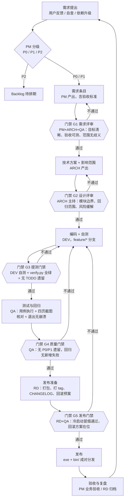
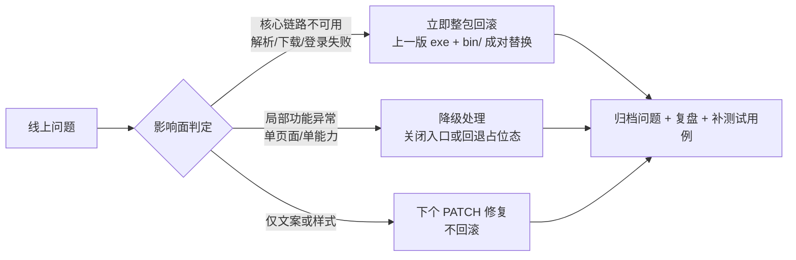

# 交付流程与角色协作机制 SOP

> 适用：B 站视频下载器（Windows 桌面端，PySide6 + Python 3.13）
> 定位：**定义"谁在什么条件下、按什么顺序、交出什么、卡在哪"**。不含代码实现细节。
> 关联文档：`使用说明.md`（用户）、`开发者指南.md`（实现与踩坑）、架构师的技术协作规范。

**基线约定（与架构师共同确认，本文档只引用不展开）**
- 版本号：`MAJOR.MINOR.PATCH`
- 分支：`main` / `develop` / `feature/*`
- 提交信息：Conventional Commits（`feat` / `fix` / `perf` / `docs` / `refactor` / `test` / `chore`），**跨模块改动必须带 scope**（如 `feat(queue):`、`fix(login):`）
- 当前基线版本 **v1.1.0**（UI 与后台整合完成）；**版本号单一真源 = `bilidownloader/__init__.py::__version__`**，UI 只读引用

---

## 1. 角色与职责

| 角色 | 核心职责 | 主要产出物 | 准入条件（何时开工） | 准出条件（何时交棒） |
|---|---|---|---|---|
| **产品经理（PM）** | 定义问题与价值、分级排期、验收业务效果 | 需求条目 / PRD、Backlog 分级表、验收结论 | 收到可复现的需求或缺陷；已确认影响的用户范围 | 需求条目含**可验证的验收标准**且已分级；设计评审通过 |
| **架构师（ARCH）** | 技术方案、模块边界、版本与分支治理、风险兜底 | 技术方案、影响范围清单、版本计划、CHANGELOG | 需求已过 G1（需求门禁），目标与验收标准明确 | 方案已评审；模块边界与回归范围明确；无未决架构问题 |
| **工程师（DEV）** | 按方案编码、自测、合入 | 功能代码、单元测试、必要的踩坑记录 | 技术方案已评审；`feature/*` 分支已建；本地环境可跑通 | 代码合入 `develop`；`verify.py` 全绿；自测清单完成；无 TODO 遗留 |
| **QA** | 质量门禁、回归、发布前把关 | 测试用例、缺陷单、回归报告、发布质量结论 | 功能在 `develop` 上可运行且冒烟通过 | 用例执行完毕；**无 P0/P1 遗留缺陷**；回归无新增失败 |
| **交付总监（RD）** | 版本节奏、发布决策、回滚执行、对外交付 | 发布包、发布记录、回滚预案、交付验收单 | QA 出具"可发布"结论；文档已同步更新 | 版本已打 tag、发布物可安装运行、CHANGELOG 已更新、回滚方案在位 |

**协作原则**
1. **单一接口人**：需求只对 PM，方案只对 ARCH，发布只对 RD。避免多头指挥。
2. **门禁不可跳**：任一门禁未过，不得进入下一阶段；确需放行须由 RD 书面例外并记录风险。
3. **争议升级路径**：PM ↔ ARCH 分歧 → RD 裁决；技术不可逆决策（破坏性变更）→ RD + ARCH 共同签署。
4. **小团队兼职**：一人可兼多角，但**门禁执行人与执行人不得是同一人**（DEV 不能自己放行自己的代码）。

---

## 2. 需求分级

| 等级 | 定义 | 判定口径 | 排期规则 |
|---|---|---|---|
| **P0** | 必须有 | 阻断发布 / 核心链路不可用（解析、下载、登录任一断）/ 安全与凭证风险 / 数据丢失 | 立即修，可打断当前迭代；进 PATCH 或阻断 MINOR 发布 |
| **P1** | 应该有 | 核心体验增强、明确的用户价值、不做会显著影响口碑 | 排入当前或下一 MINOR，允许跨一个版本延期一次 |
| **P2** | 可以有 | 锦上添花、覆盖人群小、有合规或维护成本 | 可无限延期；仅在资源空闲时捡入；不做不阻塞发布 |

### 当前 Backlog 分级示例（真实待办）

| 事项 | 现状 | 分级 | 理由 |
|---|---|---|---|
| 侧边栏「批量下载」（跨视频） | 占位禁用 | **P1** | 用户诉求明确，但必须内置防风控节流，否则易触发限流或封号 |
| 侧边栏「收藏夹」 | 占位禁用 | **P1** | 依赖登录态稳定，价值中等 |
| 侧边栏「字幕与弹幕」独立页 | 占位禁用 | **P2** | 详情页已支持勾选字幕/弹幕，独立页属增强 |
| 登录页「账号密码登录」 | 未实现 | **P2（待定）** | 合规与风控成本高、易触发验证码，倾向**不做**，改为优化扫码引导 |
| 版本号双真源不一致（缺陷） | `gui.py::APP_VERSION="1.1.0"` 与 `__init__.py::__version__="1.0.0"` 冲突 | **P0** | 侧边栏显示版本与 tag/包元数据对不上；已定单一真源，由架构师规范承接 |
| yt-dlp / ffmpeg 版本升级与校验机制 | 手工替换 | **P0** | B 站接口变动会直接导致全线失效；需内置版本检测与一键更新（不静默自动更新） |
| `data/cookies.txt` 凭证保护 | 已 gitignore | **P0** | 凭证等同账号；需防误打包、防日志打印、提供一键清除 |
| 风控自适应限速 / 重试退避 | 手工调并发 | **P1** | 影响下载成功率与账号安全 |
| 打包体积优化（现约 130MB） | 未优化 | **P2** | 不影响可用性；可裁剪 ffmpeg 与 PySide6 冗余模块 |
| 侧边栏占位项统一"即将上线"提示 | 已禁用 | **P1** | 禁用但无解释会造成困惑，属体验缺陷 |

---

## 3. 需求模板（可直接复制）

```markdown
## 需求编号：REQ-XXX   优先级：P0 / P1 / P2

### 背景
<!-- 现状是什么、谁在什么场景下遇到问题、有没有数据或反馈支撑 -->

### 目标
<!-- 1~3 条可衡量的目标。例：跨视频批量任务配置耗时从 N 步降到 1 步 -->

### 用户故事
- As a <角色>, I want <能力>, so that <收益>

### 验收标准（Given / When / Then，必须可验证）
- [ ] Given ______, When ______, Then ______
- [ ] Given ______, When ______, Then ______

### 影响范围
| 模块 | 改动类型（新增/修改/删除） | 备注 |
|---|---|---|
| 例：queue_manager.py | 修改 | 并发调度需支持批量入队 |

### 非目标（本次明确不做）
- 

### 风险与依赖
- 依赖：______ ｜ 风险：______ ｜ 缓解：______

### 优先级理由
<!-- 为什么是这个等级，不做会怎样 -->

### 状态
待评审 → 设计中 → 开发中 → 测试中 → 已发布 / 已拒绝
```

---

## 4. 版本节奏与里程碑

### 版本号规则（与架构师约定）

| 段 | 递增条件 | 示例 |
|---|---|---|
| **MAJOR** | 不兼容变更：设置文件格式破坏、最低系统要求提升、核心交互重构 | v2.0.0 |
| **MINOR** | 向下兼容的新功能（新页面 / 新能力） | v1.2.0 |
| **PATCH** | 缺陷修复、依赖升级（yt-dlp / ffmpeg）、文案与打包修正 | v1.1.1 |

### 迭代节奏建议

| 项 | 建议 |
|---|---|
| 迭代周期 | 2 周一个 MINOR 迭代；PATCH 随需发布，不设固定窗口 |
| 冻结窗口 | 发布前 **24 小时**冻结 `develop`，仅接受 P0 |
| P0 通道 | 从 `main` 拉 `hotfix/*`，修复后同时合回 `main` 与 `develop` |
| 发布检查 | 每次发布必须跑 `python verify.py`（用例数以当前脚本为准，现为 **54 项**，以脚本实际打印的 `[PASS]` 行数为准；项数变化须同步更新本说法）与 `python screenshot.py`（四页截图核对） |

### 里程碑示例

| 版本 | 主题 | 主要内容 | 分级构成 |
|---|---|---|---|
| **v1.1.x** | 整合稳定（当前基线） | UI 与后台整合、主题三态、队列调度、扫码登录 | P0 收尾 + PATCH |
| **v1.2.0** | 批量下载 | 侧边栏批量下载页、跨视频入队、风控节流与退避、占位项提示 | P1 为主 |
| **v1.3.0** | 收藏夹 | 登录态下的收藏夹拉取、批量选择、增量下载 | P1 |
| **v1.4.0** | 字幕与弹幕 | 独立管理页、字幕格式选择、弹幕转换 | P2 升级 |
| **v2.0.0** | （按需） | 仅在出现破坏性变更时启动，如设置格式重构 | — |

> 里程碑为**计划**，不是承诺。每次迭代开始前由 PM + ARCH + RD 重新确认一次范围。

---

## 5. 端到端交付流程



### 各阶段明细

| 阶段 | 输入 | 输出 | 门禁 | 主要负责人 | 参与 |
|---|---|---|---|---|---|
| **① 需求** | 用户反馈、自查问题、依赖变动 | 需求条目（含验收标准）、Backlog 分级 | **G1** 目标清晰、验收可测、范围无歧义 | PM | ARCH、QA |
| **② 设计** | 过 G1 的需求条目 | 技术方案、影响范围清单、回归范围 | **G2** 模块边界明确、风险有缓解方案 | ARCH | PM、QA、DEV |
| **③ 开发** | 过 G2 的方案 + `feature/*` 分支 | 可运行代码、自测记录、必要踩坑补充 | **G3** `verify.py` 全绿、自测通过、无 TODO | DEV | ARCH |
| **④ 测试** | 合入 `develop` 的可运行版本 | 测试用例、缺陷单、回归报告 | **G4** 无 P0/P1 遗留、回归无新增失败 | QA | DEV |
| **⑤ 发布** | QA "可发布"结论 + 已更新文档 | 发布包、tag、CHANGELOG、回滚预案 | **G5** 冷启动冒烟通过、回滚方案在位 | RD | QA、ARCH |
| **⑥ 验收** | 已发布版本 | 业务验收结论、复盘记录、新需求回流 | PM 签字确认 | PM | RD、QA |

---

## 6. DoD（Definition of Done）清单

一个功能从"写完"到"可交付"必须全部勾选。**任一未勾选 = 未完成，不得进入 G5。**

**功能与需求**
- [ ] 需求条目中所有验收标准逐条验证通过
- [ ] 边界情况已处理：空输入、网络中断、磁盘写满、任务中途退出
- [ ] 占位/未实现能力有明确的用户可见说明（如"即将上线"），不是静默禁用

**代码与工程**
- [ ] 提交信息符合 Conventional Commits，分支路径符合 `feature/* → develop → main`
- [ ] `python verify.py` **全部用例通过**（当前 **54 项**，项数变化须同步更新本说法），新逻辑已补充对应用例
- [ ] 无调试残留：`print`、硬编码路径、注释掉的代码块、TODO
- [ ] 线程安全：退出时 `QueueManager.shutdown()` 正常，无 QThread 崩溃

**界面与体验**
- [ ] `python screenshot.py` 四页截图与设计稿核对无偏差
- [ ] 颜色全部取自 `theme.py` 令牌，无写死色值；亮/暗/跟随系统三态均正常
- [ ] 关键操作有反馈（成功/失败/进行中），异常有用户能读懂的提示

**文档**
- [ ] `使用说明.md` 已更新（用户可见行为变化）
- [ ] `开发者指南.md` 已更新（含新增的踩坑记录，如适用）
- [ ] `CHANGELOG` 已记录，条目与版本号对应

**发布物**
- [ ] PyInstaller 打包通过，`bin/` 与 exe **平级且同版本**
- [ ] 干净机器上冷启动冒烟通过：启动 → 登录 → 解析 → 下载 → 完成
- [ ] 发布包中**不含** `data/` 下任何凭证文件
- [ ] 上一版本发布包已归档，回滚路径可立即执行

---

## 7. 变更与回滚策略

### 7.1 变更分级

| 级别 | 场景 | 审批 | 处理 |
|---|---|---|---|
| **L0** | 文案、图标、默认配置 | PM 决定 | 随下一个 PATCH |
| **L1** | 单模块功能改动，不改接口与数据结构 | ARCH 评估，PM 确认 | 当前 MINOR 内消化 |
| **L2** | 跨模块改动、涉及设置格式或外部接口（含 yt-dlp/ffmpeg 升级） | PM + ARCH + QA 会评 | 可能调整里程碑，需回归全量 |
| **L3** | 破坏性变更（数据结构不兼容、依赖大版本升级） | RD + ARCH 共同签署 | 升 MAJOR，必须提供迁移路径 |

### 7.2 变更流程

1. **提出**：任何人可提，统一提交给 **PM**（不接受直接找 DEV 改代码）。
2. **影响评估**：**ARCH** 给出改动模块与回归范围，**QA** 给出测试成本，DEV 估工。
3. **决策**：PM 依据分级表判定 **接受 / 延期 / 拒绝**，并更新需求条目与验收标准。
4. **同步**：结论写入 Backlog 与 `CHANGELOG`，通知全部角色；已进入开发的需求变更需重走 G1。
5. **冻结例外**：冻结窗口内只收 **P0**，须 RD 书面批准并记录风险。

### 7.3 回滚策略



**三类资产的回滚方式（关键）**

| 资产类别 | 是否纳入发布物 | 回滚方式 | 目标耗时 | 注意 |
|---|---|---|---|---|
| **应用二进制**（`BilibiliDownloader.exe`） | 是 | 按版本号归档上一版发布包，整包替换 | < 5 分钟 | exe 与 `bin/` 必须**同版本成对回滚**，错配会直接失效；回滚前查发布记录中的配对版本 |
| **依赖二进制**（`bin/yt-dlp.exe`、`bin/ffmpeg.exe`） | 是 | 依据 `bin/VERSION.json` 记录的配对版本恢复；升 yt-dlp 不动 exe 属 PATCH 热修，可单独回滚 | < 5 分钟 | 不提交进仓库（`.gitignore` 已忽略），由 `download_deps.py --pin` 复现历史组合 |
| **配置**（`data/settings.json`） | 否（用户本地生成） | 向前兼容：废弃字段保留读取，新增字段给默认值；提供"重置设置"入口兜底 | 即时 | 损坏或无法解析时不得崩溃，回落到默认配置 |
| **凭证**（`data/cookies.txt`） | **严禁纳入** | 不随发布回滚；疑似泄露时用户需在 B 站 App 端**改密使旧凭证失效**，应用侧提供一键清除 | 即时 | 应用不得上传、备份或日志打印凭证内容；发布前必查发布包是否混入 `data/` |

---

## 8. 风险登记

| # | 风险 | 等级 | 触发信号 | 应对措施 | 责任人 |
|---|---|---|---|---|---|
| R1 | **B 站接口变动**导致解析/下载/登录全线失效 | 高 | 大面积解析失败；扫码接口返回未知状态码 | 内置 yt-dlp 版本检测与一键更新（P0）；`login.py` 状态码集中管理并加未知码告警；保留 `开发者指南.md` 踩坑记录更新机制 | ARCH + DEV |
| R2 | **风控限流/封号**（批量抓取、高频请求） | 高 | 频繁 412/429；下载速度骤降；账号异常提示 | 批量功能内置节流与指数退避；并发上限保守（默认 ≤3）；设置页显著位置提示合规；不做账号密码登录 | ARCH + PM |
| R3 | **凭证泄露**（`data/cookies.txt` 误提交或误打包） | 高 | 仓库扫描命中；发布包中出现 `data/` | `.gitignore` 已覆盖；发布前 DoD 强制检查发布包；日志脱敏；提供一键清除登录态 | RD + QA |
| R4 | **打包体积与分发**（约 130MB，含 87MB ffmpeg） | 中 | 分发困难、下载慢、杀软误报 | 评估裁剪 ffmpeg 构建与 PySide6 冗余模块（P2）；提供校验值与安装说明；必要时改为分离下载依赖 | ARCH + RD |
| R5 | **版权与合规风险**（第三方内容再分发） | 中 | 用户咨询、平台通知 | 使用说明与界面显著位置保留合规提示；明确"个人学习/研究/备份"边界 | PM |
| R6 | **依赖与运行时升级**（Python 3.13 / PySide6 6.12） | 中 | 新版本发布后启动异常、样式错乱 | 锁定 `requirements.txt` 版本；升级前跑 `verify.py` + `screenshot.py` 双校验；升级列为 L2 变更 | ARCH |
| R7 | **并发与线程缺陷回归**（QThread 崩溃、信号丢失） | 中 | 退出时崩溃；进度不更新；队列假死 | 退出必须调用 `QueueManager.shutdown()`；相关改动强制跑退出用例；测试脚本必须跑事件循环 | QA + DEV |
| R8 | **关键人员单点**（项目知识集中在少数人） | 中 | 某人不可用时进度停滞 | 本 SOP + `开发者指南.md` 踩坑记录为共同知识底座；每个 P0 修复需留下复现与验证步骤 | PM + RD |

---

## 9. 附：门禁速查卡

| 门禁 | 一句话判定 | 卡住时找谁 |
|---|---|---|
| **G1 需求** | 目标清晰、验收可测、范围无歧义 | PM |
| **G2 设计** | 模块边界明确、风险有缓解方案 | ARCH |
| **G3 提测** | `verify.py` 全绿、自测通过、无 TODO | DEV |
| **G4 质量** | 无 P0/P1 遗留、回归无新增失败 | QA |
| **G5 发布** | 冷启动冒烟通过、回滚方案在位 | RD |

> 本 SOP 随项目演进更新，每次里程碑复盘后由 PM 修订一版。
